# tinyml-edge-lab

   
Small, tested building blocks for edge machine learning on my own boards (SparkFun Edge, Arduino Nano 33 BLE).
The aim is a pipeline I can explain end to end: data, features, a baseline, an exported model, and checks that
the device matches the PC.

## Honest status
* The code and its tests run in CI (`pytest`). The tests use **synthetic data in the real UCI file layout**; they
  prove the code paths, not model quality.
* The results table below comes from **one run on the official UCI HAR data** (zip checksum in `docs/DATASETS.md`). It is a first baseline, not a tuned model: the depth was fixed before running, not picked on the test set.
* The decision-tree exporter is tested by compiling the generated C with `gcc` and checking it returns the same
  class as scikit-learn on random inputs. It has not yet been run on a microcontroller.

## What is here
| Part | What it does |
|---|---|
| `src/tinyml_lab/features.py` | Window features (mean, std, rms, min, max, dominant frequency, band energies), cheap enough for a device |
| `src/tinyml_lab/uci_har.py` | Loader for the official UCI HAR data; refuses to run if a volunteer is in both splits |
| `src/tinyml_lab/export_c.py` | Exports a scikit-learn decision tree as a C function |
| `src/tinyml_lab/har_baseline.py` | Decision-tree baseline, depth sweep, per-class recall, confusion matrix |
| `src/tinyml_lab/plots.py` | Figures drawn from the saved results: confusion matrix, per-class recall, depth sweep, example windows, most-used features |
| `src/tinyml_lab/har_compare.py` | Subject-grouped model selection, richer features and a random-forest comparison |
| `src/tinyml_lab/cwru*.py` | CWRU bearing pipeline: verified download, windowing, features and honest evaluation |
| `src/tinyml_lab/footprint*.py` | Real flash and RAM sizes of the exported models, measured with the ARM compiler |
| `firmware/` | Notes for the SparkFun Edge and the Nano 33 BLE |
| `docs/DATASETS.md` | Sources, licences, evaluation rules |
| `src/tinyml_lab/edge_gesture*.py` | Desk gestures from the Edge's own recordings: loader, resampling, session-wise evaluation |
| `firmware/sparkfun_edge/gesture_features/` | The gesture features in C (1.5 KB of flash), checked against the Python features |
| `firmware/sparkfun_edge/gesture_demo/` | The whole on-device chain in C (resample to 50 Hz, window, features, model), checked against the Python chain on the PC and running on the Edge |
| `src/tinyml_lab/gesture_demo.py` | Trains and exports the deployable model, builds the C chain for the PC and compares it with the Python chain |
| `tools/edge_gesture_monitor.py` | Watches the board's gesture output over serial and points out lost lines, sensor overruns and slow windows |
| `docs/API.md` | The interfaces: the C headers, the serial protocol, the Python package and the command-line tools. Its generated parts are checked by a test, so it cannot fall behind the code |

## Quick start
```bash
python -m venv .venv && source .venv/bin/activate      # Windows: .venv\Scripts\activate
pip install -r requirements.txt
pytest -q
python scripts/download_uci_har.py                     # official UCI zip, CC BY 4.0
python scripts/train_har_baseline.py --depth 6
python scripts/make_figures.py                         # figures into results/figures/
python scripts/compare_models.py                       # grouped CV, richer features, forest comparison
python scripts/measure_footprint.py                # real flash sizes (needs the Zephyr SDK or an arm-none-eabi compiler)
python scripts/download_cwru.py && python scripts/run_cwru.py   # CWRU bearings (about 300 MB download)
python scripts/run_gestures.py                      # desk gestures: leave-one-session-out evaluation (needs recordings, see docs/GESTURES.md)
python scripts/check_edge_features.py             # the C gesture features against Python on your recordings (needs gcc)
python scripts/export_gesture_model.py            # train on every recording and write the model as C for the board
python scripts/check_gesture_pipeline.py          # the whole C chain against the Python chain on your recordings (needs gcc)
python scripts/make_api_docs.py                  # rewrite the generated parts of docs/API.md after changing a public function (a test checks it is current)
```

## Results (official UCI HAR data, run on 9 October 2026)
| Model | Nodes | Test accuracy | Macro-F1 | Notes |
|---|---|---|---|---|
| Decision tree, depth 6 | 61 | 0.797 | 0.790 | UCI's subject-disjoint test split; features from total acceleration only (no gyroscope) |

Per-class recall: walking 0.909, walking upstairs 0.715, walking downstairs 0.555, sitting 0.851, standing 0.703, laying 1.000. The weakest classes are walking downstairs and standing. This is a baseline to improve, not a strong result.

### Figures

Drawn by `scripts/make_figures.py` from the run above (`results/har_baseline.json` and the raw test windows).

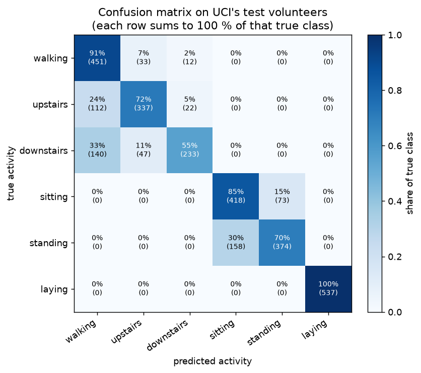
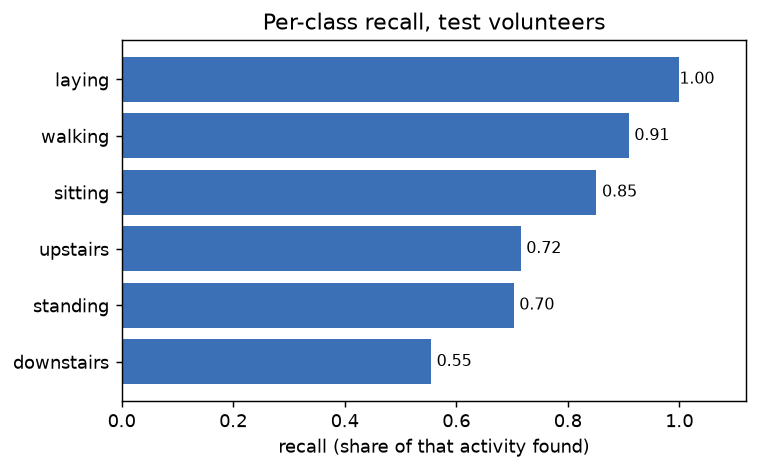
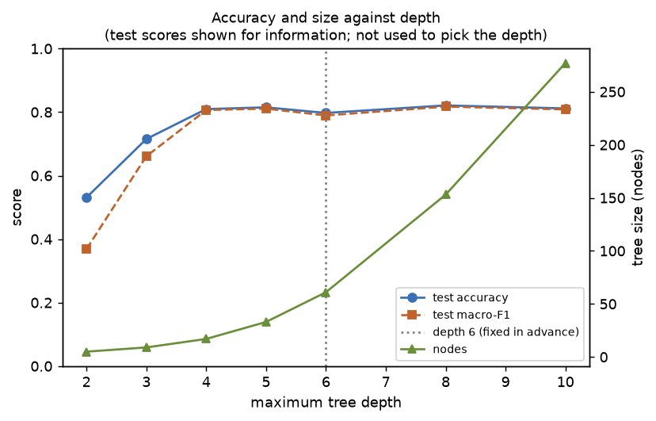
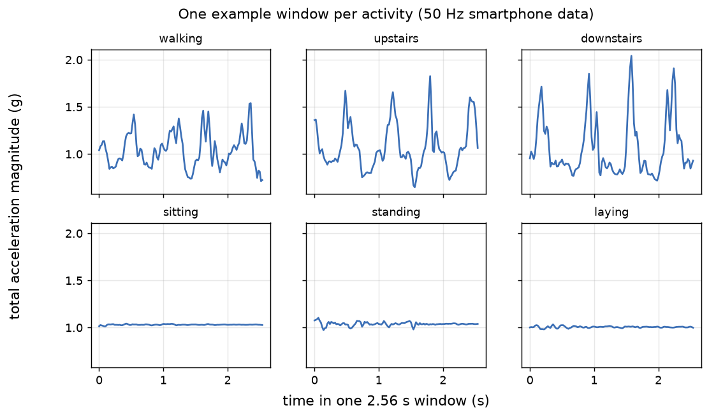
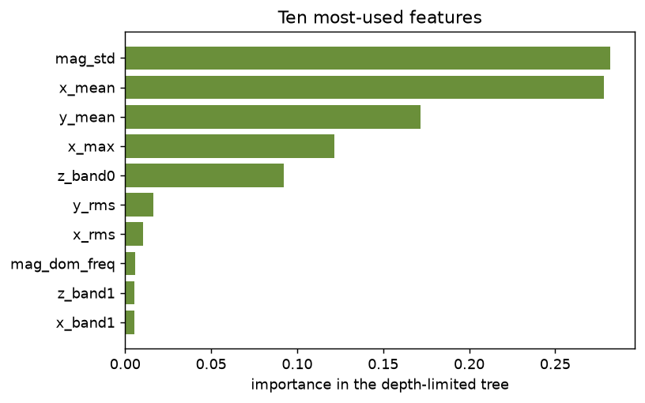

The depth plot shows test scores for information only. The depth was fixed before running and was not chosen from this plot.

<!-- compare:start -->
### Model selection and richer features

How the models were chosen:
- Depth (and forest size) came from 5-fold cross-validation on the 21 training volunteers only, with folds split by volunteer. The smallest model within one standard error of the best score was kept.
- The 9 test volunteers were used once per final model, after the choice was made.
- Extended features add UCI's body acceleration, gyroscope and gravity signals to the total-acceleration features. On a device the body/gravity separation would need a filter, which is not implemented here.

| Model | Features | Choice | Nodes | CV macro-F1 | Test accuracy | Test macro-F1 |
|---|---|---|---|---|---|---|
| Tree, depth 6 fixed in advance | baseline | fixed depth 6 | 61 | 0.816 (SE 0.034) | 0.797 | 0.790 |
| Tree, depth chosen by CV | baseline | depth 4 (CV) | 17 | 0.819 (SE 0.032) | 0.810 | 0.807 |
| Tree, depth chosen by CV | extended | depth 5 (CV) | 33 | 0.833 (SE 0.014) | 0.839 | 0.834 |
| Random forest, size chosen by CV | extended | 30 trees, depth 6 (CV) | 2186 | 0.883 (SE 0.026) | 0.879 | 0.877 |

Adding the extra features moved the compact tree's test macro-F1 from 0.807 to 0.834 (33 nodes against 17). The random forest scored 0.877 with 2186 nodes in total. The extended tree's weakest class is walking downstairs (recall 0.669).

These are single runs with 9 test volunteers, so differences of a few points should not be over-read. Measured flash sizes, including the forest's, are in the flash-size section below.

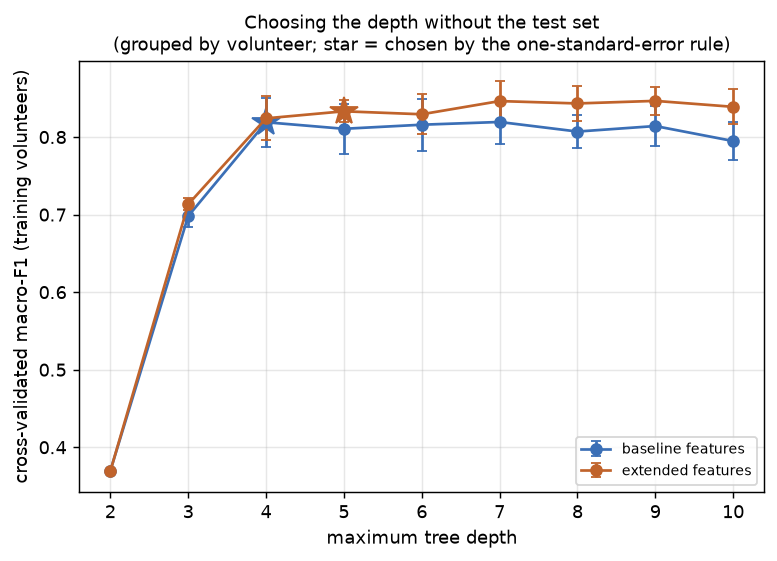
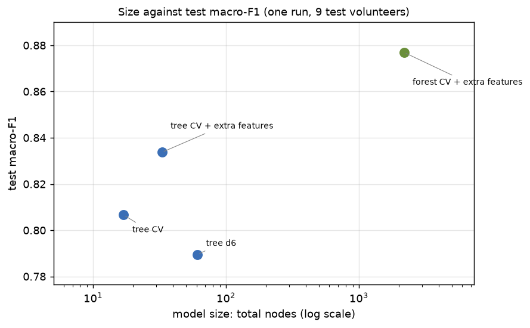
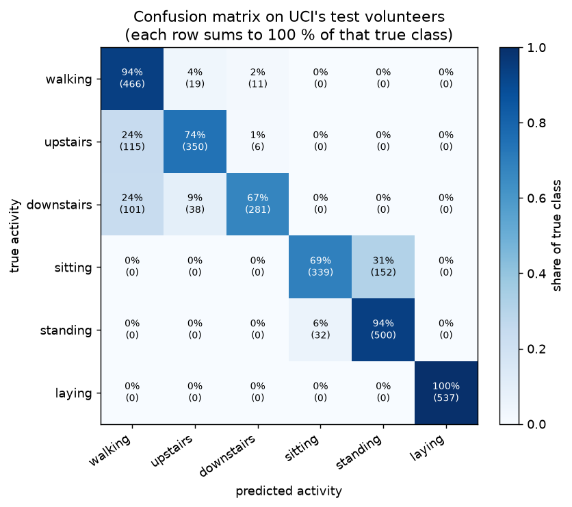
<!-- compare:end -->

<!-- cwru:start -->
### Bearing faults (CWRU, run on a PC)

- Data: 40 official recordings (normal, and drive-end inner-race, ball and outer-race faults at 0.007, 0.014, 0.021 in, at motor loads 0, 1, 2, 3 hp), all at 48 kHz so every class was recorded the same way. Each file is checked against its SHA-256 value before use.
- 4096-sample windows, five time-domain statistics and 12 spectral band fractions as features. A decision tree (depth 8) and a random forest (100 trees), settings fixed in advance and not tuned.

| Evaluation | Tree accuracy / macro-F1 | Forest accuracy / macro-F1 |
|---|---|---|
| Random split of windows (leaky) | 0.944 / 0.944 | 0.989 / 0.989 |
| Leave one motor load out | 0.911 / 0.909 | 0.946 / 0.943 |
| Leave one fault size out (3 fault types, no normal class) | 0.362 / 0.354 | 0.329 / 0.332 |
| Leave one motor load out, signals reduced to 400 Hz | 0.495 / 0.492 | 0.602 / 0.598 |

For the forest, a random split of windows scored macro-F1 0.989; holding out a whole motor load scored 0.943; holding out a whole fault size (three fault types, no normal class) scored 0.332. After reducing the same recordings to 400 Hz, leave-one-load-out scored 0.598.

Forest accuracy on each held-out fold (an average can hide a bad fold; a score below chance means the model was consistently wrong there):
- leave one motor load out: 0 hp 0.818, 1 hp 0.989, 2 hp 0.986, 3 hp 0.923
- leave one fault size out (chance is 0.333): 0.007 in 0.525, 0.014 in 0.353, 0.021 in 0.112

How to read it:
- Windows cut from the same recording are close neighbours, so a random split can let the model recognise the recording instead of the fault. That row is shown to expose the risk, not as a result.
- Every damaged bearing was recorded at all four loads, so leaving a load out is easier than meeting a new bearing. Leaving a fault size out is the harder test, because each size is a different damaged bearing.
- The 400 Hz row decimates the same recordings with an anti-alias filter. It shows what a 400 Hz sensor could see of these signals; it says nothing about any real sensor or machine.
- CWRU is a small laboratory benchmark with seeded faults. These scores do not predict field performance.

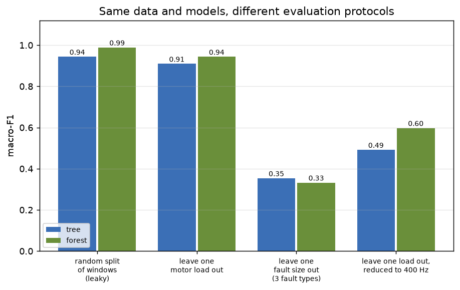
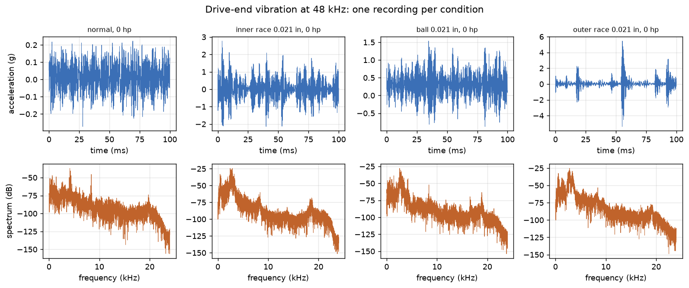
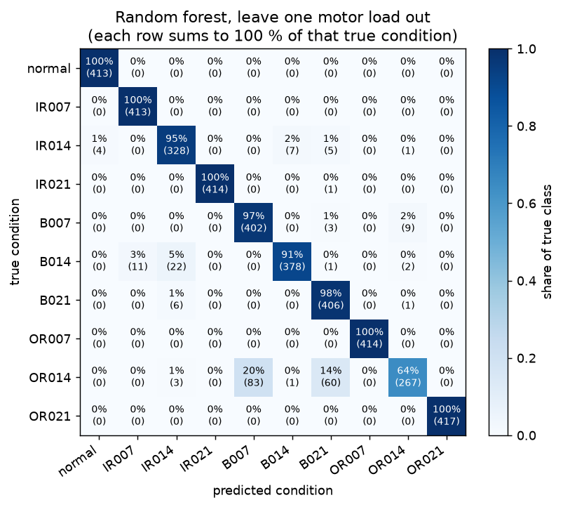
<!-- cwru:end -->

<!-- footprint:start -->
### Flash size on a microcontroller (measured with the ARM compiler)

- Each exported classifier was linked for two Cortex-M targets with `arm-none-eabi-gcc (15:13.2.rel1-2) 13.2.1 20231009` at `-Os`. Flash is code plus constants plus initialised data plus any compiler helper routines (soft-float compares on the M0+), minus an identical build with an empty stub.
- Static RAM counts static data only. **Not measured:** stack use, speed, and the feature extraction (FFT and statistics), which a device would also need. Nothing here ran on a board.
- "Same class" is how often the compiled C function, run on this PC, returns the class scikit-learn predicts, over the 2,947 test windows.

| Model | Nodes | Thresholds | Cortex-M0+ flash | Cortex-M4F flash | Static RAM (M4F) | Same class as scikit-learn |
|---|---|---|---|---|---|---|
| tree d6 | 61 | double thresholds | 1,964 B | 1,876 B | 0 B | 2947 of 2947 |
| tree d6 | 61 | float thresholds | 928 B | 552 B | 0 B | 2947 of 2947 |
| tree CV | 17 | double thresholds | 1,516 B | 1,308 B | 0 B | 2947 of 2947 |
| tree CV | 17 | float thresholds | 584 B | 128 B | 0 B | 2947 of 2947 |
| tree CV + extra features | 33 | double thresholds | 1,708 B | 1,564 B | 0 B | 2947 of 2947 |
| tree CV + extra features | 33 | float thresholds | 744 B | 320 B | 0 B | 2947 of 2947 |
| forest CV + extra features | 2186 | float thresholds | 52,244 B | 56,088 B | 0 B | 2947 of 2947 |

For the extended tree on a Cortex-M4F, rounding the thresholds down to float32 takes 320 B against 1,564 B with doubles (4.9 times smaller), with the same predictions on all 2,947 test windows. The random forest needs 56,088 B on the M4F (175 times the tree) and 52,244 B on the M0+, and returns the same class as scikit-learn on 2,947 of 2,947 windows. For scale, an nRF52840 (Nano 33 BLE) or Apollo3 (SparkFun Edge) has 1024 KB of flash (datasheet value), so the forest is 5.3% of it.

Why float thresholds are exact: for any float32 input x, `x <= t` and `x <= floor32(t)` are the same test, where floor32 rounds down to a float32. Rounding to the nearest float32 instead would flip a split when the midpoint of two adjacent floats rounds up; a test covers that case.

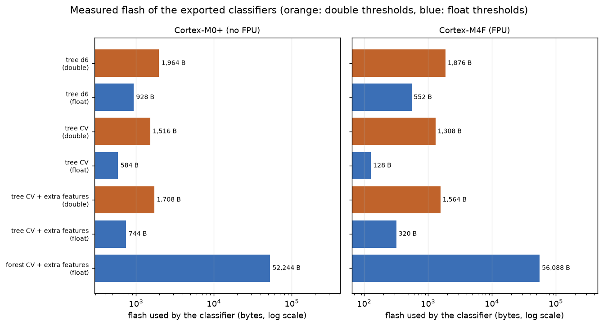
<!-- footprint:end -->

<!-- gestures:start -->
### Desk gestures (SparkFun Edge, run on a PC)

- Data: 15 recordings of 5 gestures (rest, shake_lr, shake_ud, circle, tilt) in 3 sessions (s1, s2, s3), one person and one board. Each recording was resampled to exactly 50 Hz (the accelerometer itself ran at 50.9 to 51.1 Hz for a configured 50 Hz), 2 s was trimmed at both ends, and 128-sample windows (2.56 s) were cut every 64 samples: 465 windows in total.
- Features: `raw` includes the board's orientation (window means); `motion` removes each window's mean first, so how the board was held drops out to first order.
- A decision tree (depth 6) and a random forest (100 trees), settings fixed in advance and not tuned.

| Evaluation | Features | Tree accuracy / macro-F1 | Forest accuracy / macro-F1 |
|---|---|---|---|
| Random split of windows (leaky) | raw | 0.993 / 0.993 | 1.000 / 1.000 |
| Random split of windows (leaky) | motion | 0.950 / 0.950 | 0.979 / 0.979 |
| Leave one session out | raw | 0.837 / 0.829 | 0.918 / 0.918 |
| Leave one session out | motion | 0.817 / 0.816 | 0.890 / 0.888 |

Chance accuracy is 0.200; always answering the commonest training gesture scores 0.200 when a session is held out. The best honest setting, the forest on raw features, scored macro-F1 0.918 when a whole session was held out; the same model scored 1.000 on a random split of windows. Its accuracy per held-out session: s1 0.929, s2 0.955, s3 0.871. Its weakest gesture is shake ud (recall 0.763). The best setting leads the runner-up by 0.030 in macro-F1, which is less than the 0.084 spread in its accuracy between held-out sessions, so the ranking of the settings should not be over-read.

These are 3 sessions from one person and one board, so the numbers say little about other people or other boards. Windows overlap by half, so neighbouring windows are not independent.

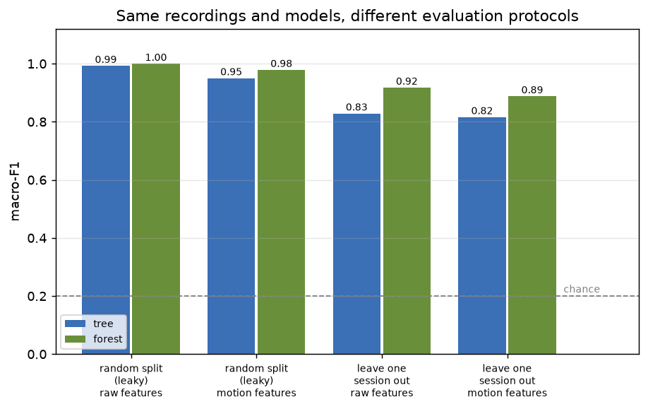
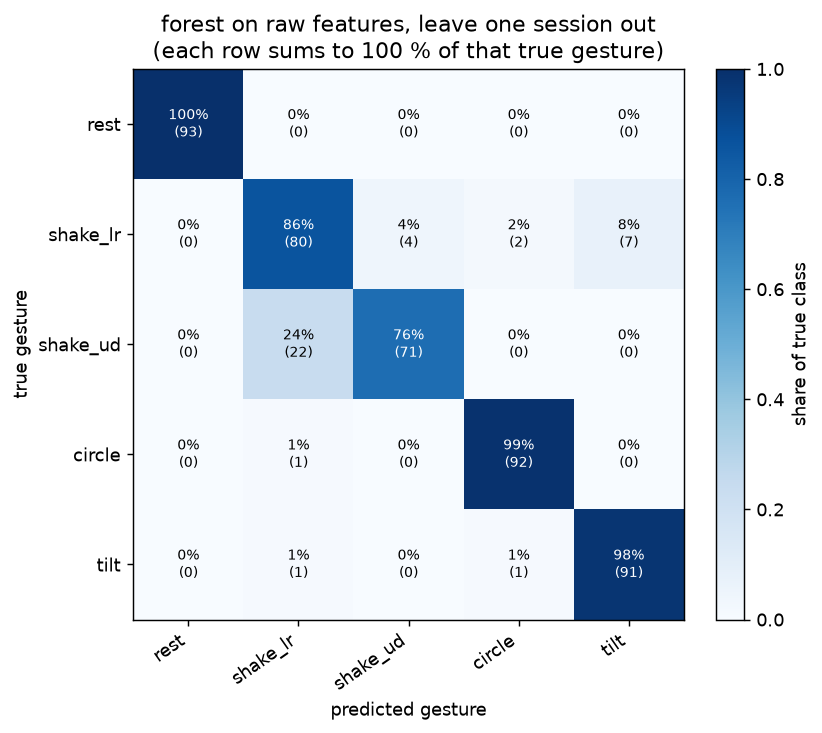
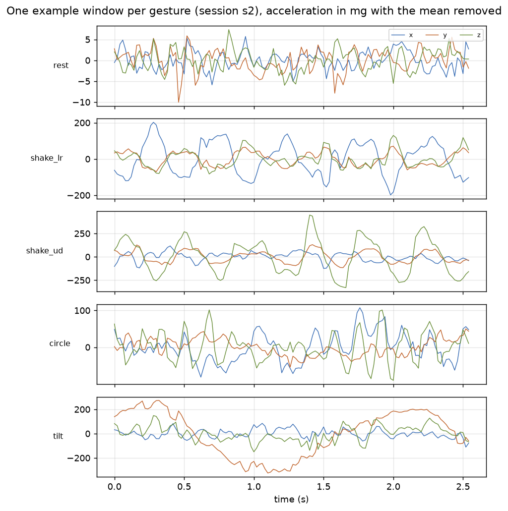
<!-- gestures:end -->

## Roadmap
1. SparkFun Edge: hello world is done and logged in `firmware/sparkfun_edge/`; the wake-word demo from the TinyML book is still to do.
2. Nano 33 BLE: IMU data logger with microSD and a TFT user interface; collect my own labelled data.
3. Compare a decision tree with a small neural network (int8), reporting size, RAM and latency.
4. Check on-device accuracy against the PC on a held-out set.
5. Signed model updates (reusing the secure-boot work).

## Licence
MIT for the code. Datasets keep their own licences (see `docs/DATASETS.md`).
