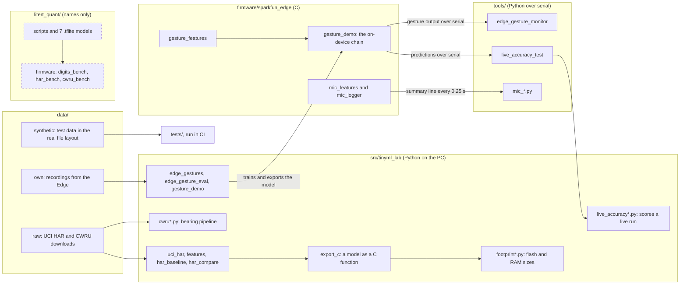
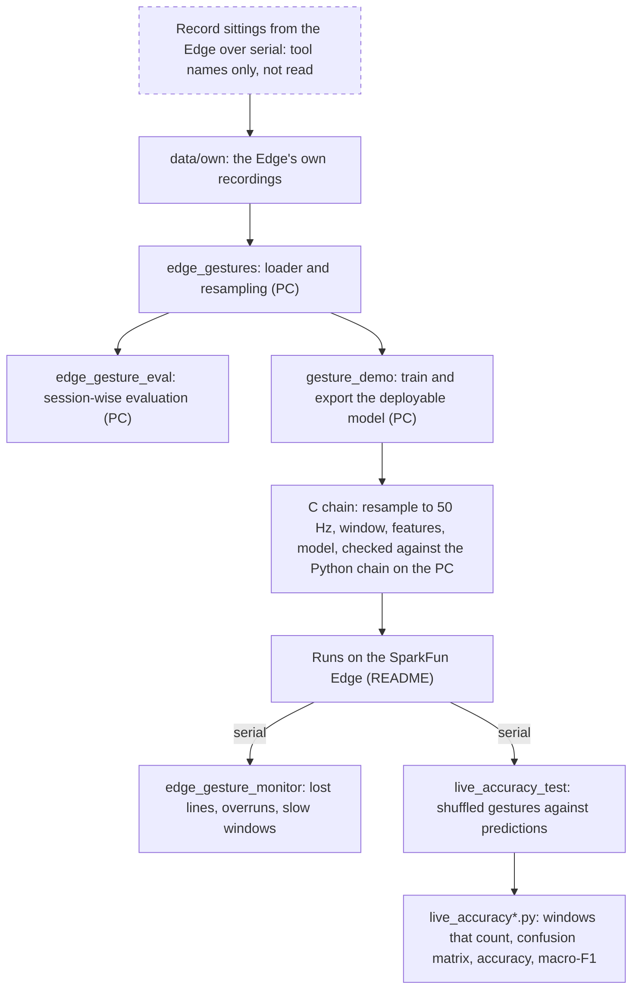

# Components of tinyml-edge-lab

Two diagrams, drawn from the README table "What is here" and the C headers in `docs/API.md`. A box with a dashed border is drawn from file and folder names only: I have not read what is inside.

## 1. The parts and what feeds what

## 2. One desk gesture, from recording to a scored live run

## Where the boxes come from

| Box | What the README says |
|---|---|
| gesture_features | The gesture features in C (1.5 KB of flash), checked against the Python features |
| gesture_demo (firmware) | The whole on-device chain in C: resample to 50 Hz, window, features, model. Checked against the Python chain on the PC and running on the Edge |
| gesture_demo.py | Trains and exports the deployable model, builds the C chain for the PC and compares it with the Python chain |
| edge_gesture_monitor | Watches the board's gesture output over serial and points out lost lines, sensor overruns and slow windows |
| live_accuracy_test and live_accuracy*.py | Gestures in a known, shuffled order while the board predicts, then a score with an interval that resamples whole blocks |
| mic_logger and mic_features | A microphone logger and the summary features in C. The README reports a mixed result: quiet detection fails when the room's noise level changes between sittings |
| tests/ | Run in CI with synthetic data in the real UCI file layout. They prove the code paths, not model quality |

## Not drawn

- What is inside `litert_quant/`. Its README has not been read for this diagram, so those boxes are dashed.
- The recording tools and `imu_logger`, `mic_probe`, `evidence` and `scripts` under `firmware/sparkfun_edge`. Names only.
- `firmware/nano33ble`, which holds a README and no code.
- The roadmap items (a bridge service, an AI layer, cloud). Not built here.
