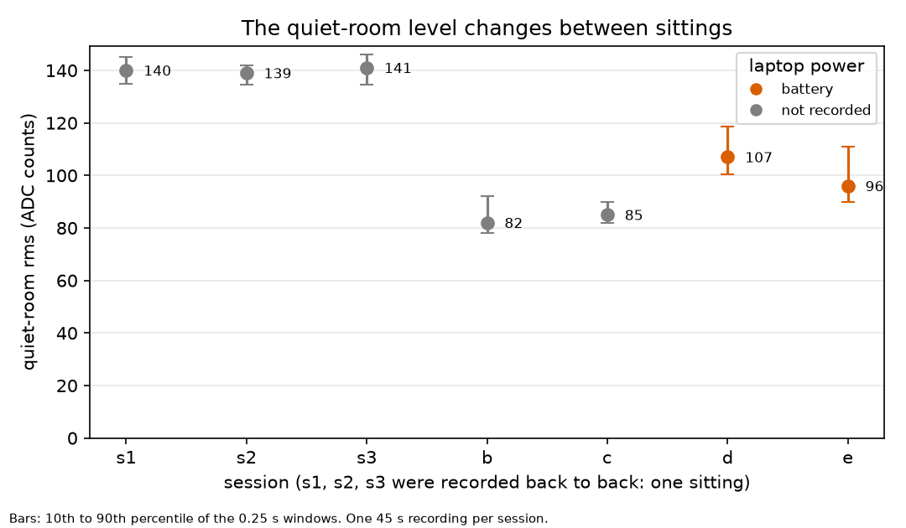
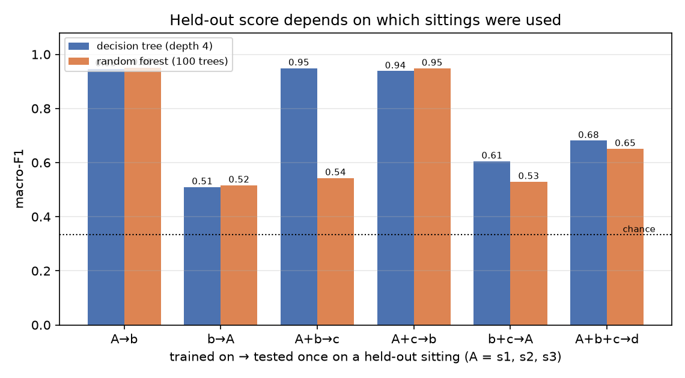

# mic_logger: a held-out test of a tiny sound classifier on the SparkFun Edge

Built with AI assistance (Claude). I specified the experiments, recorded the data, ran everything, and the numbers below
are copied from the program output. This is a small experiment with a mixed result, and the limits are stated below.

## What this is

The SparkFun Edge's analog microphone (MIC1, GPIO 29, ADC channel 1) is sampled at about 8000 Hz. Every 0.25 s (2000 samples) the
board computes five summary numbers and prints one CSV line over serial:

`w, mean, rms, peak, zcr, hf, clip, rate_hz`

`rms` is loudness, `peak` is the biggest swing, `zcr` counts crossings of the mean, `hf` is how fast the signal changes, `clip` counts
samples at 0 or 16383. The features are in `firmware/sparkfun_edge/mic_features/` (plain C, with a host test; nine deliberate bugs
were each caught by it). The firmware is `mic_logger/main.c`. The measured rate is about 7880 Hz (the timer constant was set
from a measurement on this board: a 12 MHz value gave 7447 Hz; cause not known).

Three classes: **quiet**, **speech** (talking continuously about 30 cm away, so pauses between words are labelled speech) and **knock** (one knuckle on the desk beside the board, about 4 per second).

## Recording and evaluation

`tools/mic_record_session.py` records each class for 45 s under a session name. `tools/mic_capture.py` saves every line, marks
windows `valid=0` for the first two after a reset, a rate more than 2% from the median, or after a gap, and never overwrites a file.
`tools/mic_eval.py` trains on some sittings and tests once on a sitting it never saw, with no tuning on the test sitting.
Random forest and depth-4 decision tree, features `rms, peak, zcr, hf, clip`. The 95% interval resamples 2-second blocks of the test windows; it reflects only that one test sitting, so it understates the real uncertainty.

## The sittings

| Sitting | When | Power | Notes |
|---|---|---|---|
| A (s1, s2, s3) | 28 Oct, about 17:47 to 18:04, recorded back to back | not recorded | one sitting, not three |
| b | 29 Oct, 11:35 | not recorded | |
| c | 29 Oct, 16:39 | not recorded | same day as b |
| d | 30 Oct, 11:43 | battery | |
| e | 30 Oct, 11:54 | battery | 9 minutes after d: d and e are one sitting |

Knock windows that clipped (some samples at the ADC limit): s1 0, s2 48, s3 50, b 105, c 8, d 39, e 84. My knocks varied in strength; the `clip` feature was not tested without.

## Results

Macro-F1 on one held-out sitting each (chance is about 0.33). Tests 1 to 6 used all valid windows.

| # | Trained on | Tested on | Tree | Forest | Quiet recall (tree / forest) |
|---|---|---|---|---|---|
| 1 | A | b | 0.946 | 0.950 | 1.000 / 1.000 |
| 2 | b | A | 0.510 | 0.516 | 0.000 / 0.000 |
| 3 | A, b | c | 0.949 | 0.543 | 0.994 / 0.006 |
| 4 | A, c | b | 0.938 | 0.948 | 1.000 / 0.994 |
| 5 | b, c | A | 0.605 | 0.529 | 0.126 / 0.000 |
| 6 | A, b, c | d | 0.681 | 0.651 | 0.250 / 0.176 |

Test 3 is two models disagreeing on the same data: the forest called almost every quiet window speech.

Not independent (reported for completeness): trained on A, b, c, d and tested on e, which was recorded 9 minutes after d. Uncalibrated 0.951 / 0.959, calibrated 0.970 / 0.974. I do not count this as a test.

**Exploratory check, after the fix was chosen:** trained on A, b, c; tested on d and e together as one battery sitting.

| | Tree | Forest | Quiet recall (tree / forest) |
|---|---|---|---|
| Uncalibrated | 0.845 | 0.832 | 0.618 / 0.526 |
| Calibrated | 0.949 | 0.959 | 0.949 / 0.945 |

"Calibrated" means: the first 10 s (40 windows) of each session's quiet recording give that session's own quiet level, and `rms, peak, zcr, hf` are divided by it. Those 40 windows per session are left out of every score.

## What I found

- **Knock is easy.** Recall was 0.83 to 1.00 in every test.
- **Quiet is fragile.** It works when training contains a similar quiet level and fails when the test sitting's quiet is different. Quiet `rms` was about 140 in sitting A, about 82 to 87 in later recordings, and about 107 on battery (d, and a separate 20 s check on battery). A plugged-in 20 s recording gave 87. A model learns where quiet sits in the numbers, and a shifted quiet gets called speech.
- **The cause is probably the laptop's power state.** I have one 20 s recording for each condition, not a controlled comparison. A fan-load test did not work (the fan did not speed up), so the fan is not ruled out.
- **Calibration helped on the exploratory check.** It was chosen after I saw the failures, so it is not confirmed.

## Figures

Drawn by `tools/mic_plot.py` from the recordings. The first shows the quiet-room level of each session (power state is marked only where I recorded it); the second shows the macro-F1 of each held-out test from the table above.





## Limits

- One person, one board, one desk. I have not tested other people, other rooms or other sounds.
- Only five different sittings, and b and c are the same day. Power state is not recorded for A, b or c.
- "Speech" includes pauses, so some speech windows are quiet by nature (21 in tests 1 and 4).
- The calibration and quiet test windows come from the same recording (different windows), which may flatter quiet recall.
- The fix has **not been tested on a fresh, independent sitting**. That is the next step.
- Nothing runs on the board yet: the classifier is evaluated on the PC from the summary lines.

## Reproduce

```
py tools\mic_record_session.py --port COM4 --session x --note "laptop on battery"
python3 tools/mic_eval.py --train s1,s2,s3,b,c --test d,e --compare
```

## Data

The recordings (data/own/mic) are not included in this repository (the folder is git-ignored), so the commands above need your own recordings. The sitting table lists when each of mine was recorded.
