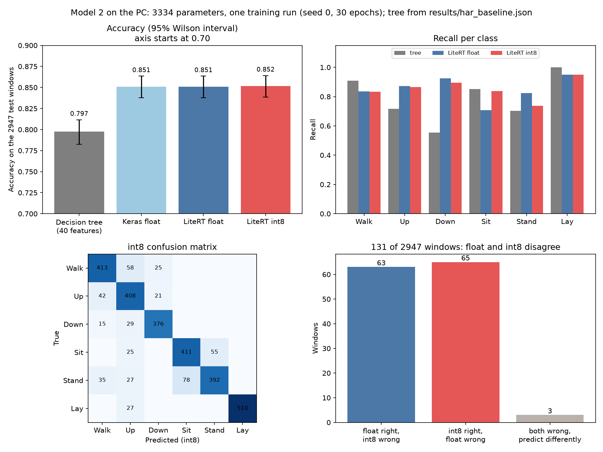
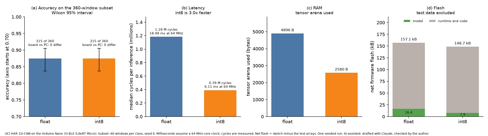
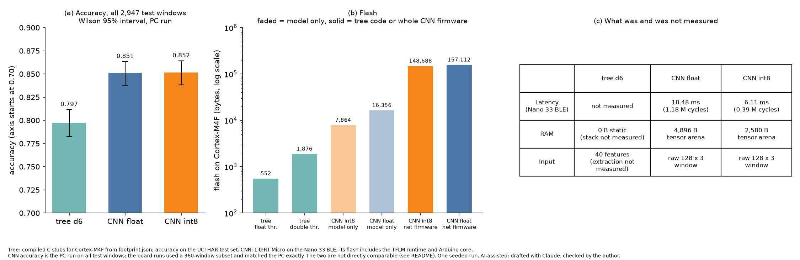

# litert_quant: float vs int8 on a Cortex-M4F

A measured comparison of a float model and a full-integer (int8) model running
under LiteRT Micro (TensorFlow Lite for Microcontrollers) on an Arduino Nano 33 BLE
(nRF52840, Cortex-M4F). Per model it reports latency per inference, RAM tensor
arena, flash size and accuracy against the float model on the same test set.

This is one folder inside the `tinyml-edge-lab` repository. Two of three planned
models are done: the 8x8 digits classifier and the UCI HAR 1D-CNN. The CWRU
autoencoder is not started.

**AI assistance:** this work was drafted with Claude and checked by the author.
Commits carry the same statement. Every number below comes from a script in this
folder or from the board's own output, and was checked by the author.

## Results (model 1, digits CNN, measured 2026-11-19)

Model: two conv layers and one dense layer, 1,898 parameters, trained once
(seed 0, 40 epochs) on 1,437 samples, tested on 360 held-out samples.

| | float | int8 |
|---|---|---|
| Correct on the board | 337 of 360 (93.61%) | 338 of 360 (93.89%) |
| Board predictions that agree with the PC run | 360 of 360 | 360 of 360 |
| Median cycles per inference (DWT counter) | 288,943 | 105,067 |
| Model size | 10,120 B | 5,424 B |
| Tensor arena actually used | 2,304 B | 1,764 B |
| Flash used by the whole sketch | 174,280 B | 169,648 B |

- Float is about 2.75 times slower than int8 on this board. The cycle spread inside
  one run is 5 cycles or less over 360 inferences.
- The accuracy difference between float and int8 is within noise. The 95% Wilson
  intervals overlap almost completely, and on the PC the two models differ on one
  sample out of 360.
- The sketch flash is almost the same for both because the runtime and the Arduino
  core dominate it. The model itself is smaller by 4,696 B for int8.
- The "global variables" figure in the compile output (62,744 B for both) includes
  a fixed 16 KB arena that the sketch reserves. It is not the arena actually used.
  The used figure above comes from the board.
- PC results are in `results/model1_pc.json` and `results/figures/model1_pc.png`.

## A finding: per-channel dense weights gave wrong results on the board

The first int8 run on the board scored 335 of 360 against 338 on the PC, and its
predictions differed from the PC on 14 samples, with identical inputs.
What the evidence shows (logs kept in `results/`):

- Ties, input handling and PC kernel choice were ruled out one by one.
- The board's output 0 matched the PC on 359 of 360 samples, while outputs 1 to 9
  were mostly wrong.
- The exported model had 10 different scales for the dense weights (per-channel).
  Recomputing the dense layer by hand with channel 0's scale for every output
  reproduced the board's raw outputs on 3,598 of 3,600 values. Using each
  channel's own scale matched only 576.
- This is consistent with the board's dense kernel applying one output scale to
  all outputs. I did not read the kernel source, so I do not claim that as the
  cause in the library, only that it explains the measurement.
- Fix: export with TensorFlow's option that makes dense weights per-tensor
  (`_experimental_disable_per_channel_quantization_for_dense_layers`). A test
  (`tests/test_dense_per_tensor.py`) fails without it and passes with it.
- After the fix the board agrees with the PC on 360 of 360 predictions, and 3,587
  of 3,600 raw outputs match exactly (the rest differ by 1).

The pre-fix logs (`board_int8_run1.*`, `board_int8_logits_run1.txt`) are kept as
evidence. The post-fix runs are `board_int8_fixed_run1.*` and `board_float_run1.*`.

The numbers above are reproduced by a committed script:
`PYTHONPATH=src python scripts/diagnose_dense_scale.py` writes
`results/dense_scale_diagnosis.json` and the figure below. The pre-fix model is kept
as `models/digits_cnn_int8_perchannel_dense.tflite`.

## Results (model 2, UCI HAR 1D-CNN, measured 2026-11-20)

Task: classify 128-sample, 3-axis accelerometer windows (50 Hz, total acceleration in
g) into six activities. Data and split are UCI's own: 7,352 training windows from 21
volunteers and 2,947 test windows from 9 other volunteers, so no volunteer is in both.
Model: three convolution layers (kernel 5, stride 2) and one dense layer, 3,334
parameters, trained once (seed 0, 30 epochs). The convolutions are written as 2D
convolutions of width 1, so the board needs only Conv2D, Reshape and FullyConnected.
The int8 export uses per-tensor dense weights (the model 1 finding above), with the
same kind of regression test.

PC run on all 2,947 test windows:

| | decision tree (depth 6) | CNN float | CNN int8 |
|---|---|---|---|
| Correct | 2,350 | 2,508 | 2,510 |
| Accuracy | 0.797 | 0.851 | 0.852 |
| Macro-F1 | 0.790 | 0.851 | 0.852 |

- The CNN beats the tree by about 5 points and the 95% Wilson intervals do not overlap.
- Float and int8 differ on 131 of 2,947 windows (63 right only for float, 65 right
  only for int8, 3 wrong for both). The 2-window int8 lead is noise.
- Per-class recall moves between float and int8: SITTING 0.707 to 0.837 and STANDING
  0.823 to 0.737. The coarse int8 input step (0.0148 g) is one possible cause. I did
  not test it.
- The tree is better than the float CNN on WALKING (0.909 against 0.835) and LAYING
  (1.000 against 0.950).
- Files: `results/model2_pc.json`, `results/model2_pc_predictions.npz`.

Board run, on a fixed subset of 360 test windows (60 per class, seed 0). The full test
set as int8 is 1.1 MB, which does not fit in the nRF52840's 1 MiB flash.

| | float | int8 |
|---|---|---|
| Correct on the board | 315 of 360 (87.50%) | 315 of 360 (87.50%) |
| Board predictions that agree with the PC run | 360 of 360 | 360 of 360 |
| Median cycles per inference (DWT counter) | 1,182,660 | 391,304 |
| Same, in ms at an assumed 64 MHz clock | 18.48 | 6.11 |
| Model size | 16,356 B | 7,864 B |
| Tensor arena actually used | 4,896 B | 2,580 B |
| Flash used by the whole sketch | 710,432 B | 287,288 B |
| of which test data (arrays in the sketch) | 553,320 B | 138,600 B |
| Net firmware flash (sketch minus test data) | 157,112 B | 148,688 B |
| of which the model | 16,356 B | 7,864 B |
| of which runtime and code | 140,756 B | 140,824 B |

- int8 is about 3.0 times faster than float on this board. The float cycle count is
  identical on all 360 windows and the int8 count varies by 4 cycles.
- Board accuracy on the subset is a tie. The subset scores higher than the full test
  set (0.875 against 0.851), so do not compare the two numbers.
- The net flash difference of about 8.4 kB is the model. Runtime and code differ by 68 B.
- Net flash is the arduino-cli sketch size minus the sizes of the test arrays, read
  with `arm-none-eabi-nm -C -S -t d` (three symbols per build kept in
  `results/model2_flash_symbols_*.txt`). The sketch size comes from
  `results/compile_har_*.txt`.
- Files: `results/device_har_float.txt` and `results/device_har_int8.txt` (raw
  captures), `results/model2_device.json`, `results/model2_flash.json`,
  `results/model2_subset.json` (subset indices and header hashes).

### Against the decision tree

- Accuracy: the CNN is better on the full test set (above).
- Flash on Cortex-M4F: the tree is 552 B (float thresholds) or 1,876 B (double
  thresholds). The CNN model alone is 7,864 B (int8) or 16,356 B (float), about 4 to 30
  times larger. The whole CNN firmware is about 149 to 157 kB, of which about 141 kB is
  runtime and Arduino core.
- These numbers are not directly comparable. The tree footprint comes from compiled C
  stubs on a PC toolchain (arm-none-eabi-gcc 13.2.1, -Os), not from a board run. Its
  RAM of 0 B excludes the stack. It has no latency figure. It also needs 40 hand-made
  features (FFT and statistics) whose cost is not counted anywhere, while the CNN reads
  the raw window and its numbers cover everything on the board.
- `results/tree_footprint.json` is a byte-identical copy of `../results/footprint.json`
  so that this folder stands alone.

### Limits for model 2

- One training run (seed 0). Nothing here says how much accuracy varies between runs.
- The board used 360 of the 2,947 test windows. The PC numbers use all of them.
- Milliseconds assume a 64 MHz clock. I did not measure the clock. Cycles are measured.
- One board, one capture per model.
- The two large input headers (1.9 MB and 0.6 MB) are not committed. They are
  regenerated by a script and checked by hash.

## Limits

- One board, one capture per model, 360 test inputs. No claim about other boards.
- One training run with one seed. Nothing here says how much accuracy varies
  between training runs.
- The same int8 sketch measured 105,178 cycles in an earlier build and 105,067 in
  the later ones (about 0.1%). I did not investigate that difference.
- Cycles are DWT counts. Converting them to time needs the clock speed, which I
  did not measure.
- The PC reference runs use the LiteRT Python interpreter. Its default XNNPACK
  delegate rewrites the graph, so checks of the model file use the interpreter
  without delegates.
- No CI workflow exists yet for this folder.

## Reproduce

PC side (Python 3.13, `pip install -r requirements.txt`, run from this folder):

    PYTHONPATH=src python scripts/run_model1.py
    PYTHONPATH=src python scripts/make_firmware_data.py
    PYTHONPATH=src python scripts/make_model1_figure.py
    pytest -q

Board side (tools used: arduino-cli 1.6.0, core `arduino:mbed_nano` 4.6.0, library
`Chirale_TensorFLowLite` 2.0.0, bossac 1.9.1):

    arduino-cli compile --fqbn arduino:mbed_nano:nano33ble \
      --build-path BUILD_INT8 --build-property "compiler.cpp.extra_flags=-DUSE_INT8" \
      firmware/digits_bench
    arduino-cli compile --fqbn arduino:mbed_nano:nano33ble \
      --build-path BUILD_FLOAT --build-property "compiler.cpp.extra_flags=-DUSE_FLOAT" \
      firmware/digits_bench

Flash with the Nano in bootloader mode (double-tap reset) using the core's own
upload pattern, `bossac -d --port=COMx -U -i -e -w file.bin -R`. Then capture and
analyse a run:

    python scripts/board_capture.py --port COM6 --out results/board_int8_run.txt
    PYTHONPATH=src python scripts/analyse_board.py results/board_int8_run.txt
    PYTHONPATH=src python scripts/make_device_figure.py

The sketch prints `START`, one `S,i,label,prediction,cycles` line per sample, and a
`DONE` line with the arena bytes used, the correct count and the model size.
The int8 build also prints the raw outputs as `L` lines.

### Model 2 (UCI HAR)

Put the UCI HAR dataset (the `UCI HAR Dataset` folder) in `../data/raw/`, which git
ignores. PC side:

    PYTHONPATH=src python scripts/run_model2.py
    PYTHONPATH=src python scripts/make_model2_figure.py
    PYTHONPATH=src python scripts/make_har_firmware_data.py

The last script writes `firmware/har_bench/*.h` and `results/model2_subset.json`. The
two large input headers are git-ignored and their SHA-256 hashes are in that JSON.
Board side, saving each compile log as `results/compile_har_float.txt` and
`results/compile_har_int8.txt`:

    arduino-cli compile --fqbn arduino:mbed_nano:nano33ble \
      --build-path BUILD_FLOAT --build-property "compiler.cpp.extra_flags=-DUSE_FLOAT" \
      firmware/har_bench
    arduino-cli compile --fqbn arduino:mbed_nano:nano33ble \
      --build-path BUILD_INT8 --build-property "compiler.cpp.extra_flags=-DUSE_INT8" \
      firmware/har_bench

Flash with bossac 1.9.1 (a bossac 1.7.0 that was first on my PATH rejected the `-i`
option). Then:

    python scripts/board_capture.py --port COM6 --out results/device_har_float.txt
    python scripts/board_capture.py --port COM6 --out results/device_har_int8.txt
    PYTHONPATH=src python scripts/analyse_har_device.py
    arm-none-eabi-nm -C -S -t d BUILD_FLOAT/har_bench.ino.elf | grep -E " (test_input_float|test_labels|g_model_float)$" > results/model2_flash_symbols_float.txt
    arm-none-eabi-nm -C -S -t d BUILD_INT8/har_bench.ino.elf | grep -E " (test_input_int8|test_labels|g_model_int8)$" > results/model2_flash_symbols_int8.txt
    PYTHONPATH=src python scripts/measure_har_flash.py
    PYTHONPATH=src python scripts/make_har_device_figure.py
    PYTHONPATH=src python scripts/make_compare_figure.py

## Predictions and scorecard

Before each run I wrote predictions with percentages and scored them afterwards from
the scripts' own output, keeping the misses. `results/scorecard.csv` holds them.
A prediction at 50% or more counts as a hit if the event happened. A prediction under
50% counts as a hit if it did not happen. `tests/test_scorecard.py` enforces the rule.
