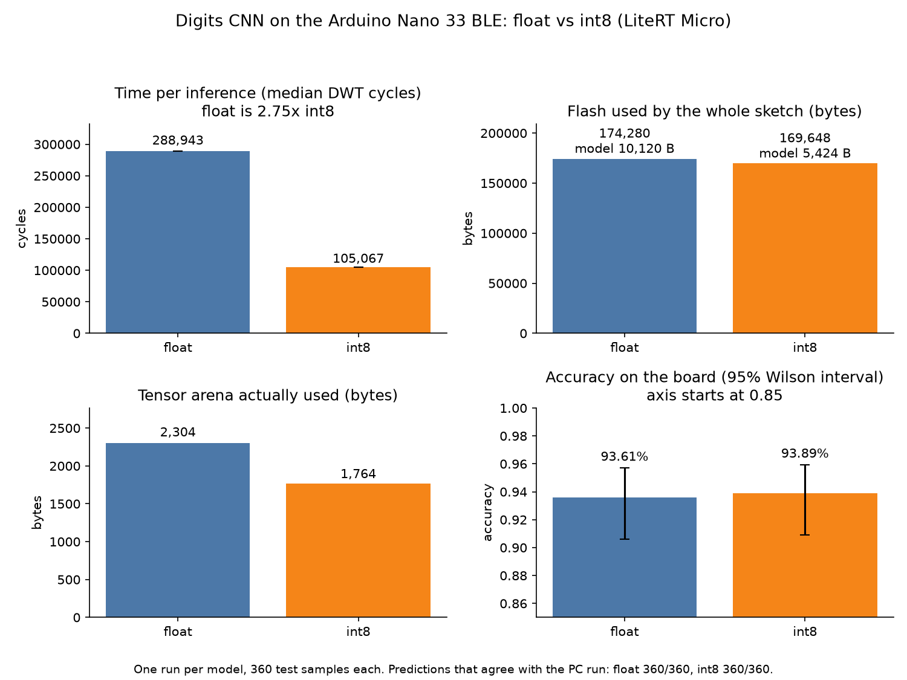
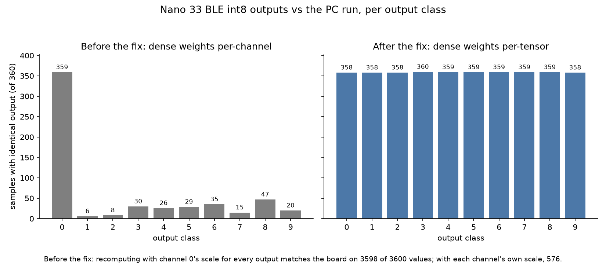

# litert_quant: float vs int8 on a Cortex-M4F

A measured comparison of a float model and a full-integer (int8) model running
under LiteRT Micro (TensorFlow Lite for Microcontrollers) on an Arduino Nano 33 BLE
(nRF52840, Cortex-M4F). Per model it reports latency per inference, RAM tensor
arena, flash size and accuracy against the float model on the same test set.

This is one folder inside the `tinyml-edge-lab` repository. Only the first of three
planned models is done (the 8x8 digits classifier). The UCI HAR 1D-CNN and the
CWRU autoencoder are not started.

**AI assistance:** this work was drafted with Claude and checked by the author.
Commits carry the same statement. Every number below comes from a script in this
folder or from the board's own output, and was checked by the author.

## Results (model 1, digits CNN, measured 2026-11-19)

Model: two conv layers and one dense layer, 1,898 parameters, trained once
(seed 0, 40 epochs) on 1,437 samples, tested on 360 held-out samples.

| | float | int8 |
|---|---|---|
| Correct on the board | 337 of 360 (93.61%) | 338 of 360 (93.89%) |
| Board predictions that agree with the PC run | 360 of 360 | 360 of 360 |
| Median cycles per inference (DWT counter) | 288,943 | 105,067 |
| Model size | 10,120 B | 5,424 B |
| Tensor arena actually used | 2,304 B | 1,764 B |
| Flash used by the whole sketch | 174,280 B | 169,648 B |

- Float is about 2.75 times slower than int8 on this board. The cycle spread inside
  one run is 5 cycles or less over 360 inferences.
- The accuracy difference between float and int8 is within noise. The 95% Wilson
  intervals overlap almost completely, and on the PC the two models differ on one
  sample out of 360.
- The sketch flash is almost the same for both because the runtime and the Arduino
  core dominate it. The model itself is smaller by 4,696 B for int8.
- The "global variables" figure in the compile output (62,744 B for both) includes
  a fixed 16 KB arena that the sketch reserves. It is not the arena actually used.
  The used figure above comes from the board.
- PC results are in `results/model1_pc.json` and `results/figures/model1_pc.png`.

## A finding: per-channel dense weights gave wrong results on the board

The first int8 run on the board scored 335 of 360 against 338 on the PC, and its
predictions differed from the PC on 14 samples, with identical inputs.
What the evidence shows (logs kept in `results/`):

- Ties, input handling and PC kernel choice were ruled out one by one.
- The board's output 0 matched the PC on 359 of 360 samples, while outputs 1 to 9
  were mostly wrong.
- The exported model had 10 different scales for the dense weights (per-channel).
  Recomputing the dense layer by hand with channel 0's scale for every output
  reproduced the board's raw outputs on 3,598 of 3,600 values. Using each
  channel's own scale matched only 576.
- This is consistent with the board's dense kernel applying one output scale to
  all outputs. I did not read the kernel source, so I do not claim that as the
  cause in the library, only that it explains the measurement.
- Fix: export with TensorFlow's option that makes dense weights per-tensor
  (`_experimental_disable_per_channel_quantization_for_dense_layers`). A test
  (`tests/test_dense_per_tensor.py`) fails without it and passes with it.
- After the fix the board agrees with the PC on 360 of 360 predictions, and 3,587
  of 3,600 raw outputs match exactly (the rest differ by 1).

The pre-fix logs (`board_int8_run1.*`, `board_int8_logits_run1.txt`) are kept as
evidence. The post-fix runs are `board_int8_fixed_run1.*` and `board_float_run1.*`.

The numbers above are reproduced by a committed script:
`PYTHONPATH=src python scripts/diagnose_dense_scale.py` writes
`results/dense_scale_diagnosis.json` and the figure below. The pre-fix model is kept
as `models/digits_cnn_int8_perchannel_dense.tflite`.

The numbers above are reproduced by a committed script:
`PYTHONPATH=src python scripts/diagnose_dense_scale.py` writes
`results/dense_scale_diagnosis.json` and the figure below. The pre-fix model is kept
as `models/digits_cnn_int8_perchannel_dense.tflite`.

## Limits

- One board, one capture per model, 360 test inputs. No claim about other boards.
- One training run with one seed. Nothing here says how much accuracy varies
  between training runs.
- The same int8 sketch measured 105,178 cycles in an earlier build and 105,067 in
  the later ones (about 0.1%). I did not investigate that difference.
- Cycles are DWT counts. Converting them to time needs the clock speed, which I
  did not measure.
- The PC reference runs use the LiteRT Python interpreter. Its default XNNPACK
  delegate rewrites the graph, so checks of the model file use the interpreter
  without delegates.
- No CI workflow exists yet for this folder.

## Reproduce

PC side (Python 3.13, `pip install -r requirements.txt`, run from this folder):

    PYTHONPATH=src python scripts/run_model1.py
    PYTHONPATH=src python scripts/make_firmware_data.py
    PYTHONPATH=src python scripts/make_model1_figure.py
    pytest -q

Board side (tools used: arduino-cli 1.6.0, core `arduino:mbed_nano` 4.6.0, library
`Chirale_TensorFLowLite` 2.0.0, bossac 1.9.1):

    arduino-cli compile --fqbn arduino:mbed_nano:nano33ble \
      --build-path BUILD_INT8 --build-property "compiler.cpp.extra_flags=-DUSE_INT8" \
      firmware/digits_bench
    arduino-cli compile --fqbn arduino:mbed_nano:nano33ble \
      --build-path BUILD_FLOAT --build-property "compiler.cpp.extra_flags=-DUSE_FLOAT" \
      firmware/digits_bench

Flash with the Nano in bootloader mode (double-tap reset) using the core's own
upload pattern, `bossac -d --port=COMx -U -i -e -w file.bin -R`. Then capture and
analyse a run:

    python scripts/board_capture.py --port COM6 --out results/board_int8_run.txt
    PYTHONPATH=src python scripts/analyse_board.py results/board_int8_run.txt
    PYTHONPATH=src python scripts/make_device_figure.py

The sketch prints `START`, one `S,i,label,prediction,cycles` line per sample, and a
`DONE` line with the arena bytes used, the correct count and the model size.
The int8 build also prints the raw outputs as `L` lines.

## Predictions and scorecard

Before each run I wrote predictions with percentages and scored them afterwards from
the scripts' own output, keeping the misses. `results/scorecard.csv` holds them.
A prediction at 50% or more counts as a hit if the event happened. A prediction under
50% counts as a hit if it did not happen. `tests/test_scorecard.py` enforces the rule.
